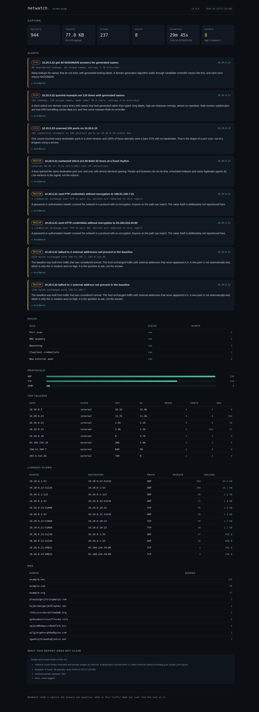

# NetWatch

**Network telemetry and anomaly detection that reads the packets itself.**

Point NetWatch at a packet capture and it gives you a ranked list of the
behaviours in that traffic that do not fit the rest of it: a host sweeping
ports, a workstation resolving generated domain names, a fixed-rhythm check-in
to an external address, a password crossing the wire in the clear, a peer
nobody talked to before.

No runtime dependencies. The pcap and pcapng readers, the protocol decoders,
the rule engine and the dashboard server are all Python standard library, so
`pip install` never pulls third-party code into a path that parses untrusted
binary input.

[](https://github.com/bougraimyou/netwatch/actions/workflows/tests.yml)
[](LICENSE)
[](pyproject.toml)

**Live demo: [bougraimyou.github.io/netwatch](https://bougraimyou.github.io/netwatch/)**
— a real report over a synthetic capture, generated by CI on every push. The
capture files are published alongside it, so you can download `mixed.pcap` and
reproduce every alert on the page.



---

## Why this exists

A capture is easy to take and hard to read. Wireshark will happily show you
40,000 packets; what you actually want to know is which one host started
talking somewhere new, and whether that rhythm at 03:14 is a backup agent or
something else.

I built NetWatch as the smaller tool I kept wanting during IT support work:
one command, a short list, every finding backed by the bytes that produced it.
It is deliberately not a dashboard you leave running for a month. It is a
second opinion on a capture you already have.

---

## Quickstart

```bash
git clone https://github.com/bougraimyou/netwatch.git
cd netwatch
python3 -m netwatch demo --out demo
```

That writes six synthetic captures, a baseline built from the quiet one, and a
report over the noisy one. Then:

```bash
python3 -m netwatch analyze demo/captures/mixed.pcap --baseline demo/baseline.json
```

```
  NetWatch 1.0.0   mixed.pcap

  packets         944     flows      237     hosts      8
  traffic     77.8 KB     window  29m44s     alerts     8
  rules    5 ran, 0 skipped

  HIGH    10.20.0.22 got 40 NXDOMAIN answers for generated names
          40 unanswered lookups, 40 unique names, entropy 3.76 bits/char
  HIGH    10.20.0.22 queried example.net 120 times with generated names
          120 lookups, 120 unique names, mean label 30.0 chars, entropy 4.21 bits/char
  HIGH    10.20.0.23 scanned 200 ports on 10.20.0.10
          201 connection attempts to 200 distinct ports on 10.20.0.10 within 60s
  MEDIUM  10.20.0.21 contacted 203.0.113.45:8443 20 times at a fixed rhythm
          interval 60.0s +/- 0.3s (CV 0.005) over 20 connections
  MEDIUM  10.20.0.21 sent FTP credentials without encryption to 198.51.100.7:21
          1 credential exchange over TCP on port 21; secrets are redacted in this report
  MEDIUM  10.20.0.21 sent HTTP credentials without encryption to 93.184.216.34:80
          1 credential exchange over TCP on port 80; secrets are redacted in this report
  MEDIUM  10.20.0.21 talked to 2 external addresses not present in the baseline
          3314 bytes exchanged with 198.51.100.7, 203.0.113.45
  MEDIUM  10.20.0.22 talked to 1 external address not present in the baseline
          1104 bytes exchanged with 198.51.100.7
```

Analyse your own traffic instead:

```bash
# one file, a folder, or a gzipped capture
python3 -m netwatch analyze capture.pcapng --html report.html

# learn what normal looks like first, then flag what is new
python3 -m netwatch baseline monday-morning.pcap --out baseline.json
python3 -m netwatch analyze friday-night.pcap --baseline baseline.json

# CI gate: exit 1 if any rule fires
python3 -m netwatch analyze nightly.pcap --fail-on-alerts -q
```

`report.html` is one self-contained file: CSS, JavaScript and the report data
are inlined, so it opens from disk, attaches to a ticket, or goes in an email
without a web server. `netwatch serve` gives you the same page over HTTP, and
`make site` builds the version published on GitHub Pages.

---

## The five rules

Five behaviours, each one explainable in a sentence, each with thresholds you
can see and override. Adding a sixth means writing its failure cases first.

| Rule | Looks for | Default threshold | Severity |
|------|-----------|-------------------|----------|
| `port_scan` | One source, many ports on one host; or one port across many hosts | 20 distinct ports, or 10 distinct hosts, within 60 s, with at least 50% bare SYNs | high |
| `dns_anomaly` | Many generated-looking names under one domain, or a flood of NXDOMAIN answers | 40 lookups in 300 s with long/high-entropy labels or 25 unique names; or 20 NXDOMAINs for unique generated names | high |
| `beaconing` | Repeated connections to one destination service at a near-constant interval | 12+ connections, 5 s to 3600 s apart, coefficient of variation ≤ 0.20 | medium |
| `cleartext_credentials` | A password sent unencrypted (FTP, HTTP Basic, form fields, SMTP AUTH, telnet) | any match on ports 21, 23, 25, 80, 110, 143, 587, 8000, 8080, 8888 | medium |
| `new_external_peer` | An external address this host never talked to in the baseline | any new peer that carried traffic; max 5 alerts | medium |

**Port scan.** Vertical and horizontal sweeps are separate questions, so they
are separate alerts. The SYN ratio is what separates a scan from a program
using many services: a scan knocks and leaves, real clients finish the
handshake. That is why the rule needs the ratio, not just the port count.

**DNS anomaly.** Two independent facts get two alerts. Generated names under
one domain (long labels, high per-character entropy, little repetition) is the
shape of DNS tunnelling. Many NXDOMAINs for names that differ from each other
is the shape of a domain generation algorithm. A DGA that invents a fresh
second-level domain per lookup cannot be caught by domain grouping at all,
which is exactly why the NXDOMAIN branch exists.

**Beaconing.** Low variance is the signal, not volume. Twenty connections a
day is nothing; twenty connections with 60.0 s ± 0.3 s between them is a
scheduler. Connections are grouped by destination service, not by 5-tuple,
because a real beacon rotates its source port and a 5-tuple view would see
twenty unrelated flows. SYN retransmits closer than one second are collapsed
first, so retry noise does not inflate the variance.

**Cleartext credentials.** The matcher records that a password crossed the
wire, how long it was, and which protocol carried it. It never stores the
value. Usernames are masked to the first and last character (`y****f`). Tests
assert that the demo password appears in neither the JSON nor the HTML.

**New external peer.** Needs a baseline, and says so instead of guessing.
Traffic in both directions counts toward the volume, because a download has
almost no outbound payload and an exfiltration has almost no inbound, and
either rule alone would miss half the cases.

---

## What a finding looks like

Every alert carries the numbers behind it and the packets that produced it.

```json
{
  "rule": "beaconing",
  "rule_name": "Beaconing",
  "severity": "medium",
  "title": "10.20.0.21 contacted 203.0.113.45:8443 20 times at a fixed rhythm",
  "summary": "interval 60.0s +/- 0.3s (CV 0.005) over 20 connections",
  "host": "10.20.0.21",
  "description": "A host opened the same destination port over and over with almost identical spacing. People and browsers do not do that; scheduled malware and some legitimate agents do. Low variance is the signal, not the volume.",
  "evidence": {
    "dst": "203.0.113.45",
    "dport": 8443,
    "proto": "TCP",
    "connections": 20,
    "source_ports": 3,
    "mean_interval_s": 60.041,
    "stdev_interval_s": 0.312,
    "coefficient_of_variation": 0.0052,
    "wire_bytes": 1080,
    "packets": 20,
    "intervals_sample_s": [60.16, 60.12, 60.42, 59.37, 60.62, 60.05, 59.6, 60.11],
    "first_seen": "2026-10-21T08:08:19.605Z",
    "last_seen": "2026-10-21T08:27:20.391Z",
    "duration_s": 1140.8
  },
  "packets": []
}
```

`packets` holds real hexdumps of the first bytes of the triggering frames,
under a 32 MB budget. When the budget is spent the report says bytes were not
retained rather than showing an empty box that looks like a bug.

---

## How it is verified

```
$ python3 -m unittest discover -s tests
Ran 166 tests in 7.0s

OK (skipped=1)
```

166 tests, stdlib `unittest`, no installs, no network. CI runs the same command
on Ubuntu, macOS and Windows across Python 3.10 to 3.13.

What the suite actually pins down:

| Area | What is asserted |
|------|------------------|
| Capture formats | pcap little and big endian, microsecond and nanosecond, pcapng section/interface/enhanced/simple blocks, gzip, FCS bits, truncated final record, wrong magic, wrong version |
| Protocol decoding | Ethernet, VLAN, QinQ, IPv4, IPv6 with extension headers, TCP, UDP, ICMP, ARP, SLL, SLL2, RAW and NULL link types; a non-first fragment is never decoded as a TCP header |
| DNS | compression pointers, response codes, compression loops rejected, label past end rejected, registrable domain, entropy |
| Aggregation | packets roll into flows, connections are counted on bare SYN rather than every packet, DNS client attribution on both query and response |
| Rules | the scenario matrix below, plus threshold boundaries, jittered beacons, slow scans, completed handshakes, disabled rules and configurable thresholds |
| Redaction | the demo password and the raw username never appear in the report JSON or the HTML |
| Rendering | embedded JSON cannot close its script tag, a hostile DNS name stays text, the self-contained page really is self-contained |
| CLI | exit codes, config typos, missing files, subprocess runs through `python -m netwatch` |
| Server | routes, JSON API, 404, HEAD |
| Generator | committed fixtures are byte-identical to a fresh build, every IPv4/TCP/UDP checksum in them is valid, frames are time ordered |

The scenario matrix is the part that would catch a regression in behaviour
rather than in plumbing. Each capture declares which rules must fire and which
must stay silent, and the suite checks both directions:

| Capture | What is in it | Must fire | Alerts |
|---------|---------------|-----------|--------|
| `clean` | DNS, HTTPS, NTP and internal admin traffic | nothing | 0 |
| `scan` | 200 bare SYNs from one workstation to one server | `port_scan` | 1 |
| `dns` | 120 generated subdomains, then 40 DGA lookups that miss | `dns_anomaly` | 2 |
| `beacon` | 20 check-ins at a 60 s rhythm | `beaconing` | 1 |
| `cleartext` | an FTP login and an HTTP Basic request | `cleartext_credentials`, `new_external_peer` | 3 |
| `mixed` | all of the above plus a new external peer | all five | 8 |

`clean` is also run against a baseline built from itself and must still produce
zero alerts, which is the cheapest false-positive test available: the traffic
that defines normal cannot be surprising to its own baseline.

Every packet in those fixtures is checked for a valid IPv4 header checksum and
a valid TCP or UDP checksum. A generator that emits byte soup would still pass
a decoder written by the same person; one that emits well-formed packets is
evidence about the decoder too.

The fixtures are regenerated with `make fixtures` and compared byte for byte
in the suite, so a demo you can see is a demo CI can reproduce.

---

## Design decisions worth knowing

**The parsers are the point.** The tool reads pcap and pcapng itself instead of
importing scapy or dpkt. Two reasons: nothing third-party sits in the path that
parses untrusted binary input, and the decoder is where packet-level
understanding is actually demonstrated. It reads pcap with either byte order
at microsecond or nanosecond resolution, pcapng with section, interface,
enhanced, simple and obsolete packet blocks, and gzip on top.

**Rules are data, and typos are fatal.** Thresholds live in JSON, not in code.
An unknown rule name or an unknown setting is a hard error with exit code 2,
because a silently ignored threshold is worse than a crash: you would believe a
rule was tuned when it was still running on defaults.

**Secrets are destroyed, not hidden.** The cleartext rule matches a password,
keeps its length, and discards the value. Nothing downstream needs it, and a
report is a file that gets emailed around. Usernames are masked. Tests grep the
serialized report for the demo password in both output formats.

**Memory is bounded on purpose.** A 2 GB capture must not become a 20 GB
process. Payload samples are capped at 512 bytes and kept only for the ten
cleartext ports; frame heads are capped at 128 bytes under a 32 MB archive
budget; each flow keeps at most 4096 connection timestamps. When a bound is
hit, the index records the truncation and the report states it, so a rule can
decline to make a claim it cannot support.

**Beacons rotate source ports.** Grouping by 5-tuple is the obvious
implementation and it misses real beacons, which open a new ephemeral port each
time. Grouping by destination service and collapsing retransmits gives the
actual rhythm.

**Address scope is explicit.** `ipaddress.is_private` reports `2001:db8::/32`
as private, which would call a documentation address internal. NetWatch uses
its own tables: RFC 1918, loopback, link-local and CGNAT as internal, `fc00::/7`
as internal, multicast and unspecified as special, everything else external.
The report states that this is a range classifier and not your actual LAN.

**The demo is deterministic.** A fixed seed and a fixed start instant mean the
synthetic captures are byte-reproducible. The report carries its generation
time; the captures do not move.

**Exit codes are a contract.** `0` success, `1` alerts found when
`--fail-on-alerts` is set, `2` error. That is what lets the tool be a step in a
pipeline rather than something you read by eye.

---

## CLI

| Command | What it does |
|---------|--------------|
| `netwatch analyze CAPTURE...` | Read captures (files, folders, `.gz`), run the rules, print a summary; `--json` and `--html` write reports |
| `netwatch baseline CAPTURE... --out FILE` | Record the external peers each internal host talked to |
| `netwatch report REPORT.json --out FILE` | Render an existing report as standalone HTML |
| `netwatch serve CAPTURE... \| --report FILE` | Serve the dashboard over HTTP (`--host`, `--port`, `--open`) |
| `netwatch collect --iface eth0 --out FILE` | Capture live traffic on Linux (needs root or `CAP_NET_RAW`) |
| `netwatch demo --out DIR` | Generate the synthetic captures, a baseline and a report |
| `netwatch rules` | List the rules, their descriptions and their defaults |

Flags worth knowing: `--baseline`, `--config`, `--fail-on-alerts`, `--quiet`.
`netwatch collect` captures everything the interface sees; there is no BPF
filter, deliberately, because a capture filter that silently drops the traffic
you needed is worse than a larger file.

---

## Tuning

Copy `examples/rules.json`, change what you need, pass it with `--config`.
Partial files are fine: anything you omit keeps its default.

```json
{
  "port_scan": { "distinct_ports": 50, "window_s": 30 },
  "beaconing": { "min_connections": 8, "max_coefficient_of_variation": 0.12 },
  "new_external_peer": { "enabled": false }
}
```

Set `"enabled": false` to switch a rule off. The report then lists it as
skipped, with the reason, instead of quietly omitting it. `netwatch rules`
prints every name and default.

---

## How it is built

```
netwatch/
  pcap.py         pcap + pcapng readers, gzip, capture writer
  packets.py      Ethernet, VLAN, IPv4, IPv6, TCP, UDP, ICMP, ARP, SLL; address scope
  dns.py          message parsing, compression, registrable domain, entropy
  flows.py        flows, hosts, DNS observations, bounded raw archive
  baseline.py     what normal looked like, as JSON
  rules.py        the five rules, thresholds, evidence, redaction
  report.py       report document: stats, alerts, rule status, limitations
  render.py       self-contained HTML report
  serve.py        four-route dashboard server
  collect.py      live capture over AF_PACKET (Linux)
  engine.py       files in, index and alerts out
  cli.py          argparse surface and exit codes
  demo.py         deterministic synthetic captures
  static/         dashboard (vanilla JS, textContent only)
tests/            166 tests and six committed captures
docs/             the published demo (generated by `make site`)
```

About 3,900 lines of Python and 500 lines of front end. `make test`, `make
site`, `make demo` and `make fixtures` are the only commands you need.

---

## What it does not do

Being specific about this is more useful than a feature list.

- **It is not an IDS.** Rules run over a finished capture, not a live stream,
  and there is no cross-capture state beyond the baseline file.
- **No TCP stream reassembly.** Payload matching is per segment. FTP USER/PASS
  is stitched across segments because that is how FTP actually behaves; an
  HTTP Basic header split across two segments can be missed.
- **No TLS inspection.** Credentials inside HTTPS are invisible, by design.
- **No BPF capture filter.** `collect` captures everything on one interface.
- **Address scope is a classifier, not your inventory.** It knows private and
  reserved ranges, not which of your subnets are supposed to talk to each
  other.
- **Domain grouping uses a built-in list of two-level suffixes** (76 entries:
  `co.uk`, `com.dz`, `com.br` and similar), not the full Public Suffix List. An
  unusual suffix will be grouped one label too deep.
- **IPv6 extension header walking is capped at eight headers**, so a crafted
  chain cannot loop the decoder.
- **Live capture is Linux-only**, because it uses `AF_PACKET` directly.
  Analysis of capture files works everywhere Python does.
- **The baseline models peers, not behaviour over time.** It will not notice
  that a host suddenly talks to a known peer at 3 a.m.

---

## Requirements and install

Python 3.10 or newer. Nothing else, on any platform.

```bash
python3 -m netwatch --help     # run from a checkout, no install
pip install -e .               # or install the `netwatch` command
```

A container image is included for the analysis path:

```bash
docker build -t netwatch .
docker run --rm -v "$PWD/captures:/captures" netwatch \
    analyze /captures --baseline /captures/baseline.json --html /captures/report.html
```

To keep the dashboard running as a service, `deploy/netwatch.service` is a
hardened systemd unit around `netwatch serve --report ...`.

---

## License

MIT. See [LICENSE](LICENSE).
